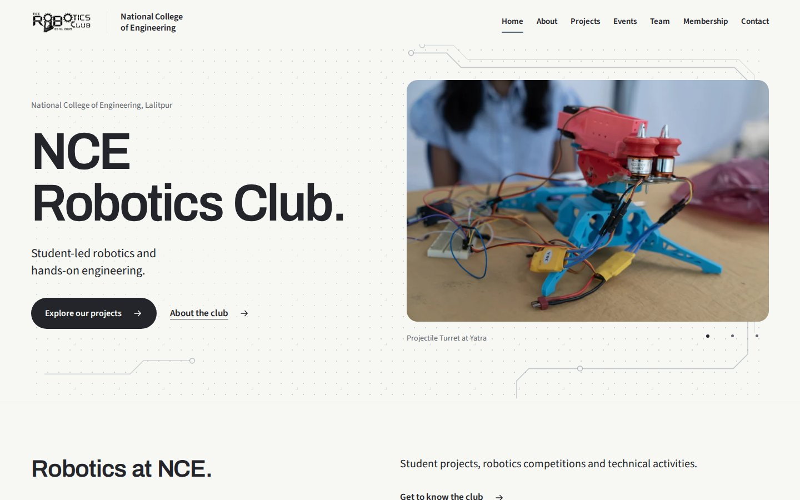

# NCE Robotics Club website

The website for NCE Robotics Club at National College of Engineering, Lalitpur,
Nepal. It brings together student projects, the Yatra event archive, committee
profiles and ways to contact the club.

[Visit the website](https://nceroboticsclub.github.io/) ·
[College website](https://nce.edu.np/) ·
[Contact the club](mailto:nceofficialroboticsclub@gmail.com)



Built with Astro and TypeScript. Pages are generated as static files, with
self-hosted photographs, fonts and icons. The galleries support manual browsing,
and the site respects reduced-motion preferences.

## Run locally

Use Node **24.16.0** and pnpm **10.34.3**, pinned in [.nvmrc](.nvmrc) and
[package.json](package.json). From your clone:

```sh
corepack pnpm install --frozen-lockfile --ignore-scripts
corepack pnpm dev
```

Open the local address printed by Astro. To preview the static build:

```sh
corepack pnpm build
corepack pnpm preview
```

## Check a change

```sh
corepack pnpm format:check
corepack pnpm check
corepack pnpm test:unit
corepack pnpm build
PORT=8051 corepack pnpm test:browser
```

For the first browser run, install Chromium with
`corepack pnpm exec playwright install chromium`. Linux may also need Playwright's
browser system libraries; its `install --with-deps chromium` command can install
them when the host permits it.

Leave port **8051** free. The browser suite serves the built `dist/`; build again
after changing the site. Reports go to `.local/` and `test-results/`. For interface
changes, also review desktop and phone layouts, keyboard focus and reduced motion.

## Contribute and publish

The [club repository](https://github.com/nceroboticsclub/nceroboticsclub.github.io)
holds the official source. Development forks submit focused pull requests to its
`main` branch. See [Contributing](CONTRIBUTING.md) for the review process.

Merging a pull request updates the source. A club maintainer then publishes the
reviewed revision through **Publish website** in GitHub Actions. The
[deployment guide](docs/deployment.md#publish-a-reviewed-release) covers publishing,
build settings and rollback.

## License and media

Source code is licensed under [Apache-2.0](LICENSE). Photographs and club/college
marks have separate usage terms; the source license does not grant permission to
reuse them. Font, icon and photograph details are in [Media and attribution](docs/media.md).
